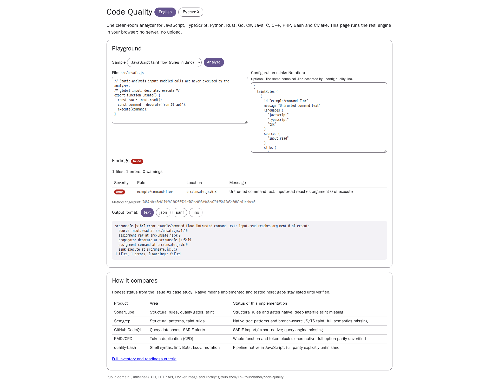

# Code Quality live demo

A static site that runs the real Code Quality engine in the browser. Analysis
needs no server and uploads nothing. It is built on the associative stack:

- The page is a Links Notation document (`src/document.js`) rendered by
  [`@link-foundation/ui`](https://github.com/link-foundation/ui) (`ui-react`
  and `ui-dom`). The playground and comparison panels are custom kinds drawn
  by React components.
- The theme is the `material3` Links Notation theme from
  `@link-foundation/ui-themes`, bundled as text.
- English and Russian strings are [`lino-i18n`](https://github.com/link-foundation/lino-i18n)
  catalogues (`src/locales/*.lino`). Pick one with `?lang=en` or `?lang=ru`, or
  let the browser language decide.
- The optional configuration is the same canonical `quality.lino` that
  `code-quality check --config` accepts. Reports are available as text, JSON,
  SARIF and Links Notation.

The engine is imported from `../../src/quality` unchanged. Small shims in
`src/shims` replace the Node built-ins it touches: a synchronous SHA-256 for
`node:crypto` and the bundled tree-sitter WASM grammars for `node:module`. Bash
uses the same pinned runtime and grammar as the CLI. Only the analysis path
runs in the browser; filesystem commands, adapters and `evolution` stay in the
CLI, API and library.

## Commands

From the repository root, run `npm ci` once (the demo imports the engine and
its parsers from the root `node_modules`). Then:

```sh
cd examples/demo-site
npm ci
npm run dev      # Vite dev server
npm run build    # static site in dist/, relative base so any subpath works
npm run preview  # serve dist/
```

`npm run smoke` serves `dist/` under `/code-quality/demo/` and drives headless
Chromium through every sample, every output format and the Russian catalogue.
It fails on any browser error. Playwright is not a dependency; CI installs a
pinned copy without saving it:

```sh
npm install --no-save --package-lock=false playwright@1.64.1
npx playwright install chromium
npm run smoke
```

The `Demo site in a real browser` job in `.github/workflows/quality-engine.yml`
runs the same build and smoke test.

## Publishing

On `main`, the `Build web app` job in `.github/workflows/example-app.yml` builds
this site into the GitHub Pages artifact under `demo/`. The demo is then served at
`https://link-foundation.github.io/code-quality/demo/`. Publishing needs a
one-time maintainer setting, Settings → Pages → Source = GitHub Actions;
`scripts/check-pages.sh` fails on `main` with that instruction until it is set.


